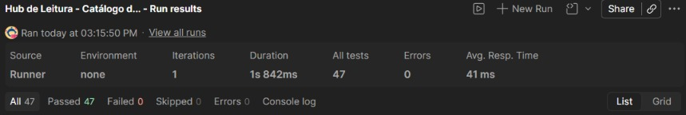

# Hub de Leitura API: Testes de API com Postman

Collection do Postman com testes automatizados da funcionalidade **Catálogo de Livros** da API [Hub de Leitura](https://github.com/EBAC-QE/hub-de-leitura-api), cobrindo cenários positivos e negativos com os métodos **GET, POST, PUT e DELETE**.

Todas as requisições têm asserções de **status code** e de **regras de negócio**.



**Resultado:** 13 requisições, 47 asserções, 47 aprovadas e 0 falhas.

---

## Tecnologias

- **Postman**: construção, organização e execução da collection
- **JavaScript**: scripts de pré-requisição e asserções (`pm.test` / `pm.expect`)
- **Node.js**: execução local da API
- **Git e GitHub**: versionamento e publicação

---

## Estratégia de testes

- **Fluxo encadeado (CRUD completo):** um livro é criado, consultado, atualizado, excluído e, por fim, é verificado que não existe mais. O ID gerado no cadastro é salvo em variável e reutilizado nas etapas seguintes.
- **Massa de dados dinâmica:** o título do livro é gerado a cada execução (`Date.now()`), evitando conflito com a regra de duplicidade e permitindo executar a collection várias vezes.
- **Base limpa ao final:** o livro criado nos testes é excluído na própria execução.
- **Sem dados sensíveis versionados:** os tokens são obtidos em tempo de execução pelo login e armazenados em variáveis da collection, que são exportadas vazias.
- **Validações além do status:** as asserções conferem mensagens, campos retornados, perfil do usuário e consistência dos dados entre as requisições.

---

## Cenários automatizados

| ID | Cenário | Método | Status esperado | Tipo |
|---|---|---|---|---|
| 00 | Login como administrador (gera o token) | POST | 200 | Pré-condição |
| 01 | Login como usuário comum (gera o token) | POST | 200 | Pré-condição |
| CT01 | Listar livros | GET | 200 | Positivo |
| CT02 | Cadastrar livro com dados válidos | POST | 201 | Positivo |
| CT03 | Buscar o livro cadastrado por ID | GET | 200 | Positivo |
| CT04 | Atualizar o livro | PUT | 200 | Positivo |
| CT05 | Excluir o livro | DELETE | 200 | Positivo |
| CT06 | Buscar o livro excluído | GET | 404 | Negativo |
| CT07 | Cadastrar livro sem token | POST | 401 | Negativo |
| CT08 | Cadastrar livro com usuário comum | POST | 403 | Negativo |
| CT09 | Cadastrar livro sem título | POST | 400 | Negativo |
| CT10 | Cadastrar livro duplicado (mesmo título e autor) | POST | 400 | Negativo |
| CT11 | Buscar livro com ID inexistente | GET | 404 | Negativo |

### Regras de negócio validadas

- Consultas ao catálogo são públicas; cadastro, alteração e exclusão exigem autenticação **e** perfil de administrador.
- Requisição sem token é recusada com **401** (autenticação); usuário autenticado sem perfil de administrador é recusado com **403** (autorização).
- `title` e `author` são obrigatórios no cadastro.
- Não é permitido cadastrar dois livros com o mesmo título e autor.
- Quando `available_copies` não é informado, a API assume o mesmo valor de `total_copies`.
- A alteração feita no PUT é persistida: o título retornado na exclusão já reflete a atualização.
- Um livro excluído deixa de ser retornado pela API (404).

---

## Como executar

### Pré-requisitos

- [Node.js](https://nodejs.org/) 18 ou superior
- [Git](https://git-scm.com/)
- [Postman](https://www.postman.com/downloads/) (desktop)

### 1. Subir a API localmente

```bash
git clone https://github.com/EBAC-QE/hub-de-leitura-api.git
cd hub-de-leitura-api
npm install
npm start
```

A API fica disponível em `http://localhost:3000` e a documentação Swagger em `http://localhost:3000/api-docs`.

> **Observação (npm 11 ou superior):** se o `npm install` exibir avisos de `allow-scripts` para `sqlite3` e `bcrypt`, autorize e reconstrua esses pacotes antes do `npm start`:
>
> ```bash
> npm approve-scripts sqlite3 bcrypt
> npm rebuild sqlite3 bcrypt
> ```

### 2. Importar a collection

1. Clone este repositório ou baixe o arquivo `hub-de-leitura-catalogo-livros.postman_collection.json`.
2. No Postman, clique em **Import** e selecione o arquivo.

### 3. Executar os testes

1. Com a API rodando, clique na collection **Hub de Leitura - Catálogo de Livros** e depois em **Run**.
2. Mantenha a ordem das requisições (as primeiras geram os tokens e os dados usados nas seguintes).
3. Clique em **Run Hub de Leitura - Catálogo de Livros**.

O resultado esperado é de **47 asserções aprovadas**.

---

## Estrutura do repositório

```
hub-de-leitura-api-postman/
├── evidencias/
│   └── evidencia-runner.png
├── hub-de-leitura-catalogo-livros.postman_collection.json
└── README.md
```

---

## Próximos passos

- Executar a collection via linha de comando com **Newman**.
- Integrar a execução a uma pipeline de **CI/CD** com GitHub Actions.
- Ampliar a cobertura com testes exploratórios de atualização parcial (PUT) e validação de limites dos campos.

---

## Autora

**Laura Ajala**: Quality Engineer | Manual & Automated Testing

[GitHub](https://github.com/laurajala)
